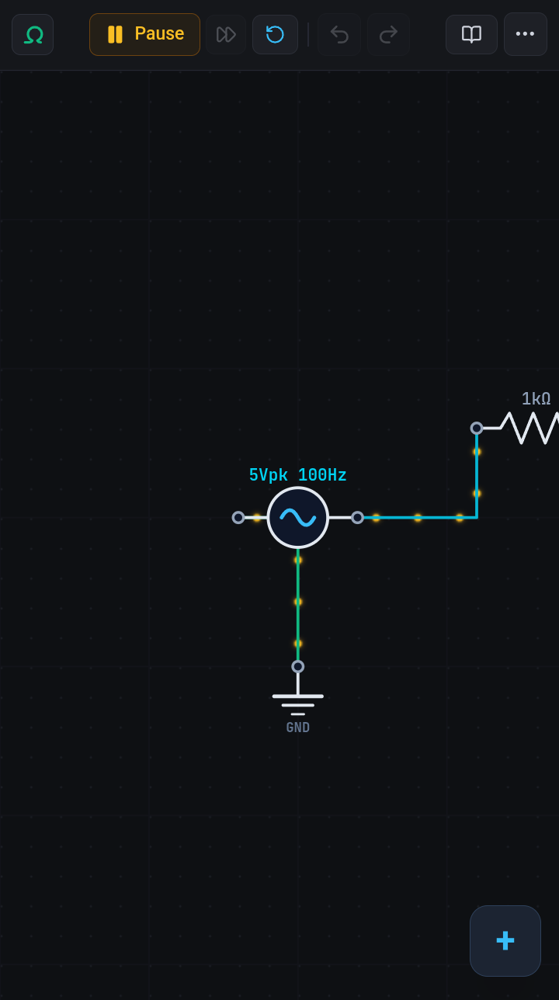
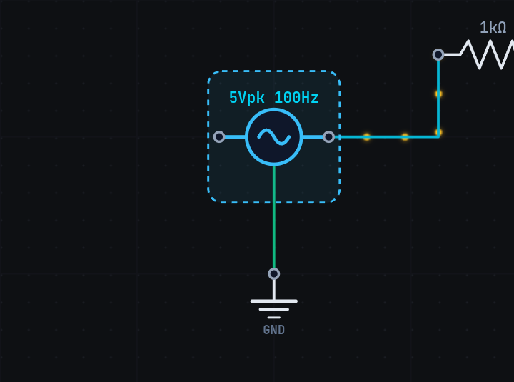

# Ohm-E — Interactive Electronics Circuit Simulator

Ohm-E is a browser-based interactive electronics circuit simulator powered by a real-time Modified Nodal Analysis (MNA) transient solver. Design circuits on an infinite snapping schematic grid, wire terminals with obstacle-avoiding orthogonal routing, toggle switches and adjust live controls while running, and inspect signals on a multi-channel digital oscilloscope.

---

## Preview

<table>
  <tr>
    <td align="center" valign="top">
      
      <br />
      <sub><b>Workspace &amp; Simulation Canvas</b> — Compact simulation bar, voltage-colored traces, animated current particles, and quick-add palette trigger.</sub>
    </td>
    <td align="center" valign="top">
      
      <br />
      <sub><b>Selected Component &amp; Orthogonal Routing</b> — Selected 5 Vpk / 100 Hz AC source routed orthogonally around components to GND and load.</sub>
    </td>
  </tr>
</table>

---

## Core Capabilities

- **In-Browser Physics Engine**: Modified Nodal Analysis (MNA) matrix solver with Newton-Raphson non-linear iteration (diodes, Zeners, LEDs, BJTs, MOSFETs, logic thresholds, 555 timer) and backward Euler numerical integration for capacitors and inductors.
- **Snap-to-Grid Schematic Editor**: 20 px grid alignment, pan and zoom (`0.4x`–`2.5x`), Fit-to-View and `1:1` reset controls, Undo/Redo history, and `90°` component rotation.
- **Smart Orthogonal Wiring**: Automatic Manhattan wire routing keeps traces clean and avoids cutting straight through component symbols. Dragging a wire onto an existing wire automatically creates a junction node.
- **Live Visualization & Audio**: Color-coded node voltages, toggleable charge flow particles (**Conventional**, **Electron**, or **Off**), glowing/dimming LEDs and filament bulbs, spinning DC/AC motors with live RPM, and synthesized Web Audio buzzer tones.
- **Fault & Short-Circuit Detection**: Real-time toast alerts detect direct terminal shorts (even while paused), low-resistance source dead shorts, burned-out LEDs/bulbs, and ohmmeters probing powered circuits.
- **Automatic Persistence**: Workspaces, simulation settings, and oscilloscope configuration automatically save to `localStorage` so you can pick up right where you left off.

---

## Getting Started & How to Use

### 1. Add Components
- **Desktop**: Browse or search the permanent **Components Library** sidebar on the left and filter by category (`All`, `Sensors`, `Passives`, `Active`, `Power`, `Logic & I/O`, `Meters`). Click any part to place it onto the canvas.
- **Mobile**: Tap the floating **`+`** button in the bottom-right corner to open the component drawer.

### 2. Wire Terminals
- Click or drag from any component terminal ring (`pin`) to another terminal ring to create an orthogonal wire.
- Connect a pin to the midpoint of an existing wire to split it with an automatic junction.

### 3. Inspect & Edit Parameters
- Click a component to open its **Property Inspector** (right sidebar on desktop, bottom drawer trigger on mobile) and tune resistance, capacitance, inductance, voltage, frequency, duty cycle, turns ratio, or threshold levels.
- Interactive parts work directly on the canvas: click **SPST Switches** to toggle open/closed, press **Push Buttons**, and drag **Potentiometer**, **LDR**, **Thermistor**, or **Sound Sensor** quick sliders right on the schematic.

### 4. Keyboard Shortcuts & Controls

| Action | Desktop Control | Mobile Control |
| :--- | :--- | :--- |
| Run / Pause simulation | `Space` or Toolbar button | Toolbar **Run / Pause** button |
| Rotate selected part | `R` | Floating selection bar **Rotate** |
| Delete selected item | `Del` or `Backspace` | Floating selection bar **Delete** |
| Deselect / cancel wire | `Esc` | Floating selection bar **Close (`X`)** |
| Undo / Redo | `Ctrl/Cmd + Z` / `Ctrl/Cmd + Y` (`Shift+Z`) | Toolbar **Undo / Redo** buttons |
| Pan canvas | Drag empty background | Drag background |
| Zoom canvas | Mouse wheel / View buttons (`Fit`, `1:1`) | Pinch-to-zoom / View buttons |

---

## Supported Components (44 Parts)

### Power & Signal Sources
| Component | Description |
| :--- | :--- |
| **DC Voltage Source** | Constant DC voltage supply (`+` / `-`) |
| **AC Generator** | Variable peak voltage and frequency sine wave generator |
| **Square Wave Generator** | Bipolar symmetrical square wave oscillator |
| **Pulse Wave Gen (PWM)** | Configurable frequency, amplitude, and editable duty cycle |
| **Ground (0V Ref)** | Zero-volt reference node (`GND`) |

### Passives & Magnetics
| Component | Description |
| :--- | :--- |
| **Resistor** | Linear resistive element (`Ω`, `kΩ`, `MΩ`) |
| **Potentiometer** | 3-terminal variable resistive divider (`A`, `B`, `Wiper`) |
| **Capacitor** | Electrostatic energy storage (`pF`–`F`) |
| **Inductor** | Magnetic flux storage (`µH`–`H`) |
| **Transformer** | Magnetically coupled isolated primary/secondary coils (`P1/P2`, `S1/S2`) |

### Semiconductors & Lamps
| Component | Description |
| :--- | :--- |
| **PN Junction Diode** | Rectifier diode with forward voltage drop |
| **Zener Diode** | Reverse breakdown voltage regulator |
| **Light Emitting Diode (LED)** | Current-driven luminescent diode (red, green, blue, yellow, white; blows if overdriven) |
| **Incandescent Light Bulb** | Thermal filament lamp with rated voltage and burnout protection |
| **NPN / PNP BJT Transistors** | Bipolar junction amplifiers and switches (`Base`, `Collector`, `Emitter`) |
| **N-Channel / P-Channel MOSFETs** | Voltage-controlled FET switches (`Gate`, `Drain`, `Source`) |

### Controls, ICs, Digital Logic & Actuators
| Component | Description |
| :--- | :--- |
| **Operational Amplifier** | High-gain differential analog amplifier (`+`, `-`, `OUT`) |
| **555 Timer IC** | Precision timer (`GND`, `TRIG`, `OUT`, `RESET`, `CTRL`, `THRESH`, `DISCH`, `VCC`) |
| **4-Bit ADC / 4-Bit DAC** | Analog-to-digital and digital-to-analog converters (`D0`–`D3`) |
| **7-Segment Display** | Multi-segment numeric LED indicator (`a`–`g`, `dp`, Common Cathode or Anode) |
| **Logic Gates** | `AND`, `OR`, `NOT`, `NAND`, `NOR`, `XOR`, `XNOR` gates with configurable logic threshold |
| **SPST Switch & Push Button** | Latching toggle switch and momentary push button |
| **SPDT Relay** | Electromagnetically actuated switch (`COIL+`, `COIL-`, `COM`, `NC`, `NO`) |
| **DC Motor & AC Motor** | Electromechanical actuators with live RPM readout |
| **Piezo Buzzer** | Frequency-driven audio transducer (audible when Audio is unmuted) |

### Meters & Sensors
| Component | Description |
| :--- | :--- |
| **Voltmeter** | High-impedance live terminal voltage readout |
| **Ammeter** | Low-impedance in-line branch current readout |
| **Ohmmeter** | Resistance tester (warns automatically if placed across a powered live circuit) |
| **Photoresistor (LDR)** | Light-dependent resistor controlled in Lux |
| **NTC Thermistor** | Temperature-dependent resistor (`°C` and Beta curve) |
| **PIR Motion Sensor** | Motion-triggered digital/analog sensor module |
| **Analog Temp Sensor** | Linear `10 mV/°C` temperature probe |
| **Sound / Mic Sensor** | Acoustic sensitivity sensor module |

---

## Multi-Channel Oscilloscope

Ohm-E includes a docked digital oscilloscope designed to inspect only the targets you select:

- **Up to 3 Simultaneous Channels**: Select components or wires while the scope is open (or click the waveform icon on any selected item) to probe up to 3 targets (`CH1` Orange, `CH2` Cyan, `CH3` Emerald Green). Remove channels individually at any time.
- **Voltage & Current Traces**: Toggle **`V`** and **`I`**. When inspecting a single channel, voltage and current (dashed amber) can be viewed together; with 2–3 channels active, switch cleanly between unified voltage or current comparison.
- **AUTO Scale & Controls Drawer**:
  - **AUTO**: Automatically selects optimal `Volts/div` and `Time/div` to frame periodic signals.
  - **VOLTS**: Vertical scale from `10 mV/div` to `20 V/div`, vertical offset slider (`-4` to `+4 div`), and `DC` / `AC` coupling.
  - **TIME**: Horizontal timebase from `50 µs/div` up to `1 s/div`.
  - **TRIG**: Sub-sample edge triggering with **Rising** or **Falling** slope selection to eliminate horizontal jitter.
- **Live Telemetry**: Continuous **Max**, **Min**, **Freq**, and **RMS** readouts for the active channel, plus **RUN / HOLD**, waveform buffer clear, and panel expand/collapse controls.

---

## Export & Import

Open **Export** from the top toolbar (or mobile `...` menu) to choose from five export pipelines:

| Format | Extension | Output Details |
| :--- | :--- | :--- |
| **JSON** | `.json` | Full schematic topology, component parameters, and oscilloscope timebase/scale settings. |
| **PDF** | `.pdf` | Vector A4 landscape schematic sheet with scaled orthogonal traces, labeled components, title block, and BOM table. |
| **PNG** | `.png` | 2x high-resolution raster snapshot auto-cropped to circuit bounds over a blueprint grid. |
| **Chip Package** | `.chip.json` / `.svg` | Encapsulates external circuit nets into a reusable `DIP-8`, `DIP-16`, or `DIP-20` IC package with a downloadable pinout SVG diagram. |
| **PCB Layout** | `.kicad_pcb` / `.svg` | Generates a 2-layer FR4 board (`F.Cu` & `B.Cu`) with component footprints, ENIG pads, vias, silkscreen labels, Manhattan copper routing, and PCB artwork SVG export. |

Use **Import** to load any saved `.json` schematic back into the simulator with validation toast feedback.

---

## Built-In Preset Circuits

Load ready-to-simulate circuits anytime from the **Circuits** menu:
1. **RC Low-Pass Filter** — AC sine wave attenuation and phase lag
2. **RLC Underdamped Tank** — Pulse-excited resonant ringing
3. **Interactive Switch & LED** — Series switch, current limiter, and glowing LED
4. **Potentiometer Voltage Divider** — Live adjustable voltage ratio with Voltmeter
5. **Full-Wave Bridge Rectifier** — 4-diode AC-to-DC bridge with reservoir capacitor smoothing
6. **BJT Transistor LED Driver** — Saturated NPN low-side switch driven by a pulse generator

---

## Local Development

### Tech Stack
- **Frontend**: React 19, TypeScript, Tailwind CSS v4, Lucide React
- **Build Tool**: Vite 8
- **Simulation & Rendering**: Custom TypeScript MNA engine, SVG schematic renderer, HTML5 Canvas current particles & oscilloscope CRT display, Web Audio API buzzer synthesis

### Scripts

```bash
# Install dependencies
npm install

# Start the development server on http://localhost:3000
npm run dev

# Type-check the codebase
npm run lint

# Build production bundle into dist/
npm run build
```
